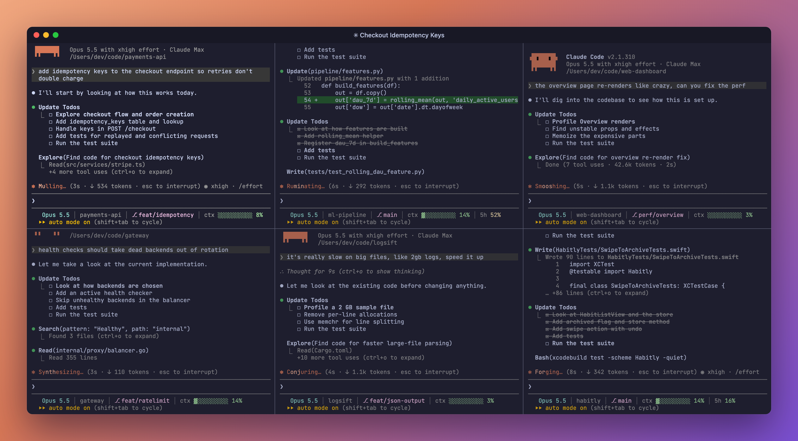
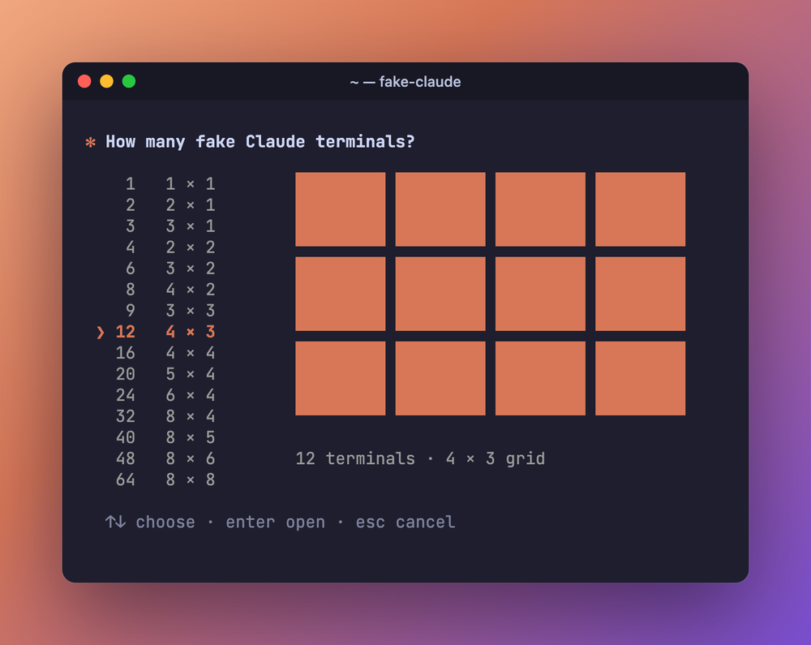
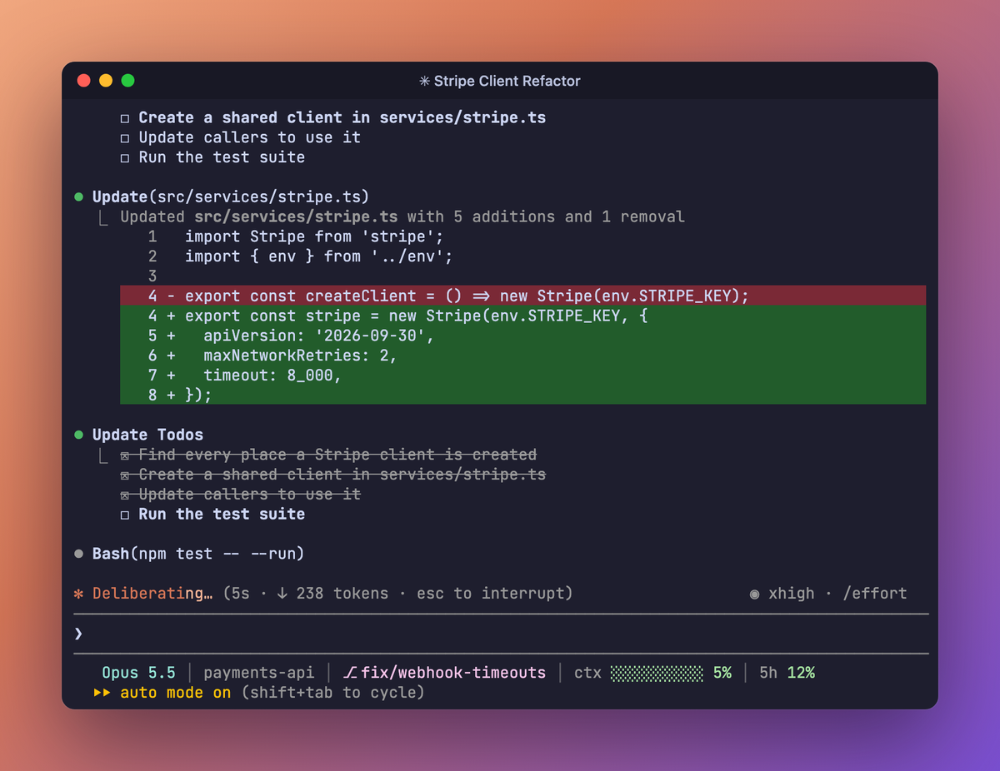
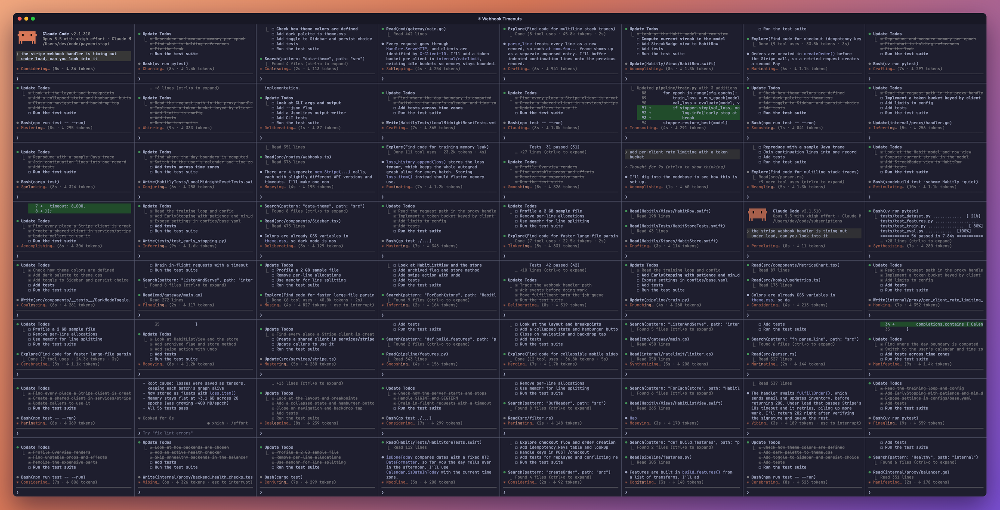

<div align="center">

# ✻ fake-claude

**A wall of Claude Code sessions, all hard at work. None of it is real.**

`fake-claude` fills a Ghostty window with up to 64 terminals that look exactly like Claude Code grinding through tasks: reading files, writing diffs, running tests, ticking off todos. It's all scripted: no API, no tokens, no network.



</div>

## Quick start

You need macOS, [Ghostty](https://ghostty.org) 1.3 or later, and Python 3.9 or later (the `python3` from Apple's Command Line Tools works). No packages to install.

```sh
brew install --cask ghostty
git clone https://github.com/ConnorSawaya/fake-claude.git ~/fake-claude
~/fake-claude/install.sh
fake-claude
```

`install.sh` links `fake-claude` and `fakeclaude` into `~/.local/bin`, so a `git pull` keeps them up to date.
The first time you run it, macOS asks whether your terminal may control Ghostty. Click **OK**.

## Pick your grid

Run `fake-claude`, choose a size with the arrow keys, and press Enter. Every option fills the screen evenly, from 1 terminal up to an 8 × 8 wall of 64, with a live preview of the layout.

<p align="center"></p>

In a hurry? `fake-claude 24` skips the picker.

## Up close

Each pane is a convincing Claude Code session: the orange logo and version header, a spinner with a ticking timer and token counter, real-looking diffs, test runs that sometimes fail before getting "fixed", a todo list that fills in, and a status bar with model, repo, branch and context meter.

<p align="center"></p>

## Go big

Past 32 terminals the grid stays 8 columns wide and adds rows. The text shrinks, and small panes switch to a compact layout so they're still all action.



## What it fakes

- **6 made-up projects** (a payments API, an ML pipeline, a React dashboard, a Go gateway, a Rust CLI, an iOS app), each with hand-written tasks, and **6 repo names each**, so a 36-pane wall never repeats a name
- **The whole workflow**: thinking, Explore agents, searches, file reads, diffs, new test files, test runs, summaries, `✻ Baked for 1m 12s`
- **Living details**: a shimmering spinner with whimsical verbs, a blinking dot on running tools, a context meter that fills up and triggers a fake "Compacting conversation", window titles that follow the task
- **Autopilot**: each pane types its own prompts with human-ish pauses, and panes start out of step so the wall never moves in sync

## Controls

Every pane is interactive:

| Key | What happens |
| --- | --- |
| type + <kbd>Enter</kbd> | it "works" on your prompt |
| <kbd>Esc</kbd> | interrupt: *Interrupted · What should Claude do instead?* |
| <kbd>Ctrl</kbd>+<kbd>C</kbd> twice | quit; the pane closes |

## One session, any terminal

`fakeclaude` is the single fake session, and it runs in any terminal app, no Ghostty needed:

```sh
fakeclaude              # random project
fakeclaude --project 3  # pick one: 0-35 (six projects × six repo names)
fakeclaude --manual     # no autopilot; only works on what you type
```

Tweak what it shows with environment variables:

| Variable | Default |
| --- | --- |
| `FAKECLAUDE_MODEL` | `Opus 5.5` |
| `FAKECLAUDE_EFFORT` | `xhigh` |
| `FAKECLAUDE_PLAN` | `Claude Max` |
| `FAKECLAUDE_VERSION` | your installed Claude Code's version, else `2.1.310` |
| `FAKECLAUDE_HOME` | your home folder (projects appear under `<home>/code`) |
| `FAKECLAUDE_SPEED` | `0.75`; higher is faster |

## How it works

```
fake-claude ──► grid.applescript ──► Ghostty ──► fakeclaude × N
 (picker)        (builds the grid)    (splits)     (draws a fake session)
```

1. **`fake-claude`** shows the picker, then hands the count and column count to the grid script.
2. **`grid.applescript`** uses Ghostty's AppleScript support to open a window, split it into columns and rows, even out the sizes, and start `fakeclaude --project N` in each pane.
3. **`fakeclaude`** is just under 1,000 lines of standard-library Python. It takes over the screen like Claude Code does, redraws about 14 times a second, and plays through a scripted task one timed step at a time. The token counts, line counts and timings are made up as it goes.

Want your own tasks? Each project in `fakeclaude` is a plain dict: add a `T(...)` entry with a prompt, todos, an explanation, a diff and a summary.

## Troubleshooting

- **Panes say "Operation not permitted".** macOS keeps apps out of Documents, Desktop and Downloads. Clone the repo somewhere else (like `~/fake-claude`), or give Ghostty access in System Settings → Privacy & Security → Files and Folders.
- **Nothing opens.** Check that Ghostty is 1.3 or later, and that your terminal is allowed to control Ghostty in System Settings → Privacy & Security → Automation.
- **The grid is the wrong size.** Ghostty opens the window at its default size. Add `maximize = true` to `~/.config/ghostty/config` so it fills the screen.

## Disclaimer

This is a fan-made toy. It is not affiliated with or endorsed by Anthropic. Claude and Claude Code are trademarks of Anthropic, PBC.
It never talks to Claude or any other service; everything on screen is scripted. Have fun, and don't use it to fool anyone who'd actually mind.

## License

[MIT](LICENSE)
